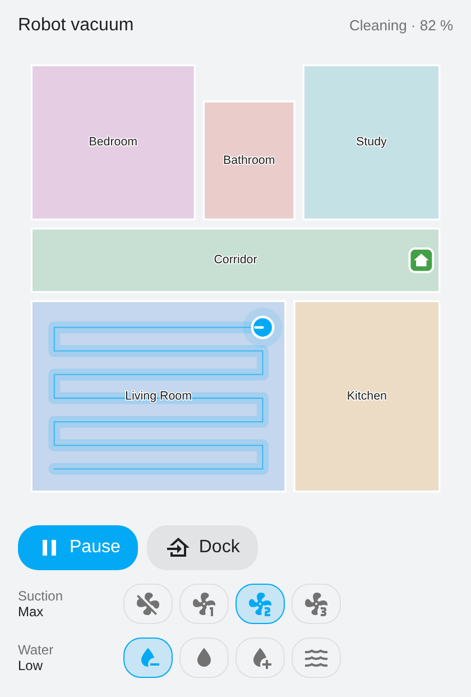
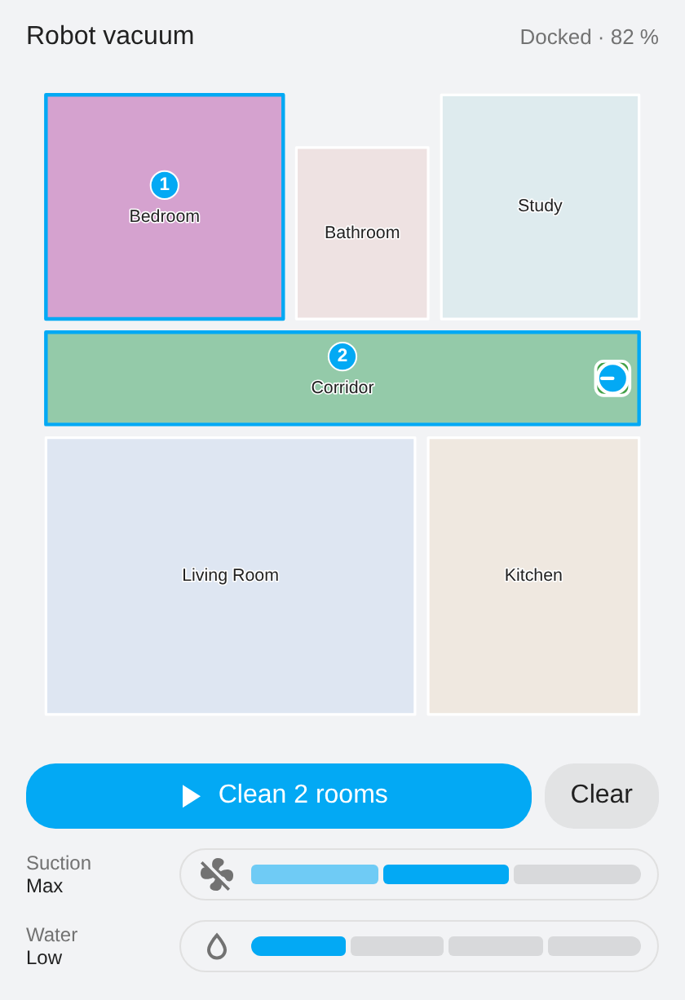

#  yeedi for Home Assistant

A Home Assistant integration for **yeedi** robot vacuums, through the yeedi cloud account.

> **Only tested with a yeedi vac max** (class `04z443`), on Home Assistant 2026.11. Other yeedi models (vac 2, vac 2 pro, vac hybrid, vac station, 2 hybrid, mop station) use the same protocol and are declared, but have not been tried: please open an issue to report what works or not.

yeedi is an Ecovacs brand: the robots speak the same protocol as the Deebots, but the official Ecovacs integration cannot log into a yeedi account. This integration logs in with the yeedi application identity and reuses [deebot-client](https://github.com/DeebotUniverse/client.py), the library behind the official integration, with the yeedi specifics added (login, model sheets, map discovery).

## Features

- Configuration in the UI (e-mail, password, country), credentials stored by Home Assistant
- `vacuum` entity: start, pause, stop, return to dock, locate, fan speed (Standard / Max / Max+) and **mop only** (vacuum motor off)
- Room cleaning with the native **segments** of Home Assistant (`vacuum.clean_area`), rooms cleaned in the order given
- `vacuum.send_command` with `spot_area` (`rooms: "2,1,3"`) and `custom_area`
- Sensors: battery, error, area and duration of the last cleaning, totals, consumables (main brush, filter, side brush)
- **Suction power** select (Standard / Max / Max+ / mop only) and **water flow level** select
- **Map card included**: rooms, dock, robot and trace of the current cleaning, room selection by tapping the map

## Installation

### HACS

1. HACS → Integrations → ⋮ → *Custom repositories*, add `https://github.com/ciscouf-ops/ha-yeedi` as an *Integration*.
2. Install **yeedi**, restart Home Assistant.
3. Settings → Devices & services → *Add integration* → **yeedi**, enter the account used in the yeedi app.

### Manual

Copy `custom_components/yeedi` into your `config/custom_components/` folder and restart Home Assistant.

## Room cleaning

Rooms are exposed as segments: in the UI, the vacuum's more-info dialog lets you pick rooms. In an automation:

```yaml
action: vacuum.clean_area
target:
  entity_id: vacuum.yeedi
data:
  segments:
    - "874128701_2"   # <map id>_<room id>, as listed by the entity
```

or with the raw room ids:

```yaml
action: vacuum.send_command
target:
  entity_id: vacuum.yeedi
data:
  command: spot_area
  params:
    rooms: "2,1,3"
    cleanings: 1
```

The room ids and names are in the `rooms` attribute of the vacuum entity.

## Map card

The integration ships its own Lovelace card, loaded automatically (no extra resource to add):

<p align="center">
  &nbsp;&nbsp;
  
</p>

*Preview rendered with a fictional flat; the card draws the outlines your robot reports.*


```yaml
type: custom:yeedi-map-card
entity: vacuum.yeedi_vac_max
title: Vacuum          # optional
controls: true         # optional: buttons, suction and water level under the map
room_names:            # optional: your own room names (room id -> name)
  2: Living room
  3: Bedroom
```

Room names come, in this order, from `room_names`, from the Home Assistant area each room is associated with (vacuum entity settings → segments), and from the robot.

Tap rooms to choose them (the numbers give the cleaning order), then **Clean**. With no room chosen, **Clean** starts a full cleaning. The trace is drawn from the positions the robot reports while it cleans.

**Zone** switches the map to zone mode: draw a rectangle on the plan, then **Clean the zone** (the robot's `custom_area` command). No-mop zones and virtual walls set in the yeedi app are drawn in red; the robot applies them whatever you start from Home Assistant.

yeedi robots only send the outline of their rooms now and then, mostly while cleaning. The integration asks for the outlines when a cleaning starts and keeps them once received, so the map may stay empty until the first cleaning after installation. Until then, the card shows the rooms as a list to choose from.

## Known limitations

- Only the yeedi vac max has been tested. Other models may expose different settings or report their map differently.

- Room names are the generic ones reported by the robot (Living room, Bedroom…). Custom names from the yeedi app are not available through the cloud API.
- No map image (walls and floor) as in the yeedi app: the card draws the outline of the rooms reported by the robot.
- The robot does not report the mop-only setting: the integration keeps the last one set from Home Assistant. Changing the suction level in the yeedi app turns mop only off in Home Assistant.
- The account must not require a device verification e-mail more than once; if yeedi asks for a code, the flow will prompt for it.

## Troubleshooting

**No robot found after signing in.** Check that the robot shows up in the yeedi app with the same account and country. Robots the integration does not know yet are logged at startup (`Robot … is not supported yet`): open an issue with that log line.

**yeedi asks for a verification code.** New locations trigger an e-mail with a code; the setup flow prompts for it. If the code is refused, request a new one from the flow rather than reusing an old e-mail.

**The map card is empty (no rooms drawn).** The robot sends the room outlines mostly while cleaning. Start a cleaning from the card or the app; the outlines are requested at that moment and kept afterwards. Until then the card lists the rooms as buttons.

**Room names are wrong or generic.** Associate each room with a Home Assistant area in the vacuum entity settings (⚙ → *Clean rooms*); the card follows that. Names given in the yeedi app are not available through the cloud API.

**The card does not reflect an update.** The card URL carries a fingerprint of the file, so a Home Assistant restart is enough; if an old version still shows, hard-refresh the page (Ctrl+F5).

**Something else.** Download the diagnostics from the device page (⋮ → *Download diagnostics*; credentials and identifiers are redacted) and attach them to the issue, together with the Home Assistant log lines mentioning `yeedi` or `deebot_client`.

## Credits

- [deebot-client](https://github.com/DeebotUniverse/client.py) and the Home Assistant Ecovacs integration, which this integration is built on.
- [ecovacs-deebot.js](https://github.com/mrbungle64/ecovacs-deebot.js), whose yeedi support documented the login differences.

## Disclaimer

This is a community project, not affiliated with, endorsed by or supported by yeedi or Ecovacs. yeedi and Ecovacs are trademarks of their respective owners; the brand images are used only to identify the devices this integration works with.
