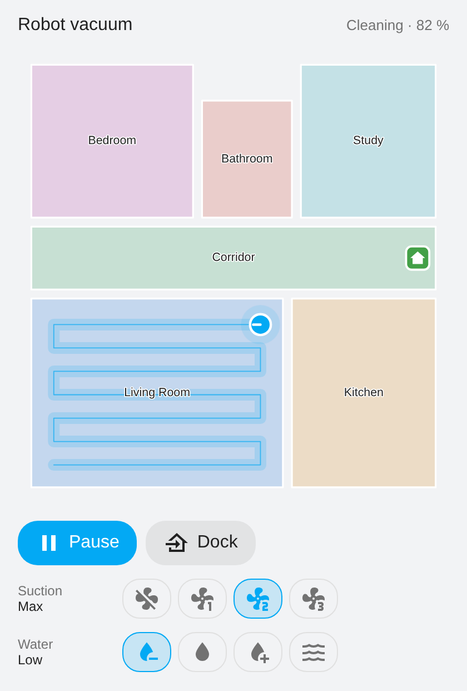
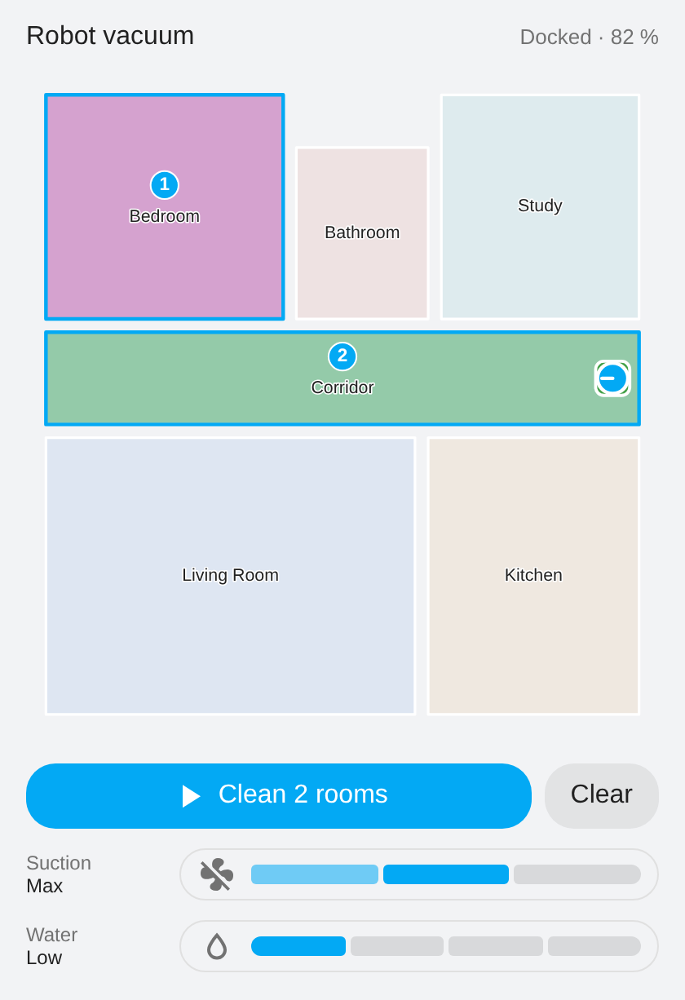
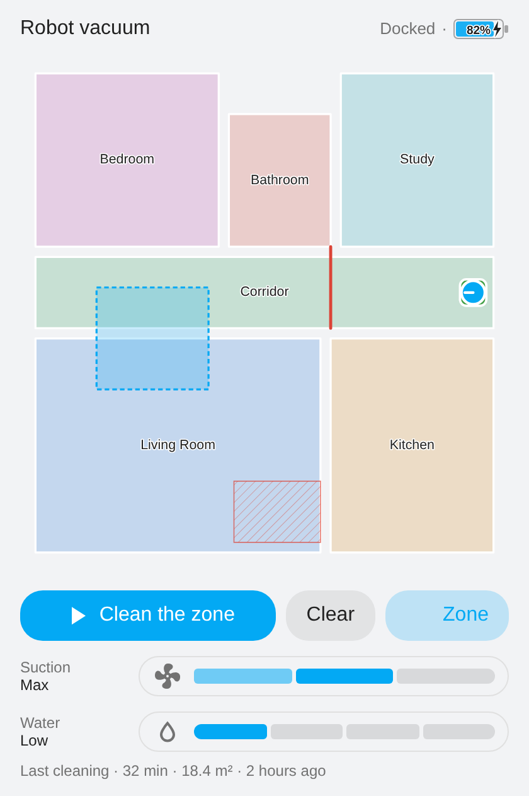
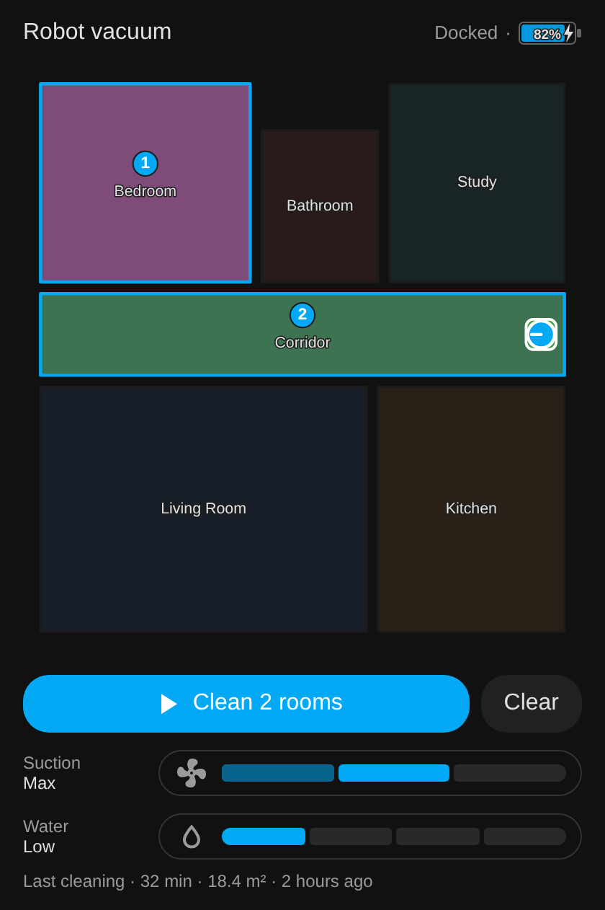
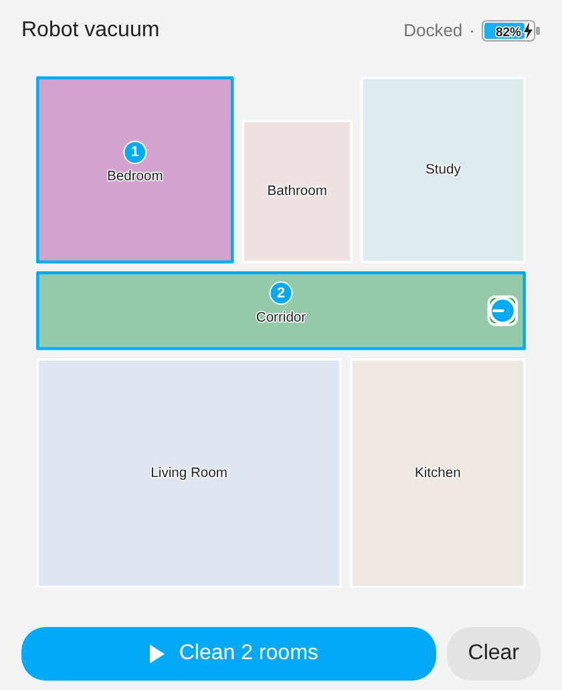
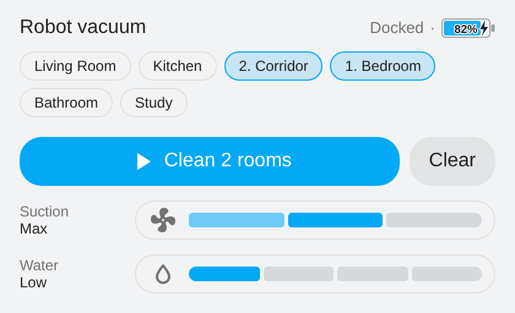

#  yeedi for Home Assistant

A Home Assistant integration for **yeedi** robot vacuums, through the yeedi cloud account.

> **Tested with a yeedi vac max** (class `04z443`, on Home Assistant 2026.11) **and, by users, with a yeedi vac station** (class `mnx7f4`) **a yeedi M16 Infinity** (class `4e64gs`) **and a yeedi 2 hybrid** (class `p5nx9u`). Other yeedi models are declared on a best-effort basis and have not been tried: please open an issue (with the diagnostics file, see Troubleshooting) to report what works or not.

| Model | Class | Dock | Status |
|---|---|---|---|
| yeedi vac max | `04z443` | auto-empty station | tested |
| yeedi vac hybrid | `h041es` | auto-empty station | declared |
| yeedi vac station | `mnx7f4` | auto-empty station | tested by a user (#1, #3) |
| yeedi vac 2 | `9t30w8` | auto-empty station | declared |
| yeedi vac 2 pro | `aaxesz` | auto-empty station (optional bundle) | declared |
| yeedi cube | `6r6dbt` | auto-empty station | declared |
| yeedi 2 hybrid | `p5nx9u` | charging dock | tested by a user (#5), room outlines drawn wrong on the map card (being looked at) |
| yeedi mop station / mop station pro | `vthpeg`, `zwvyi2` | mop-washing station (no station entities yet) | declared |
| yeedi M16 Infinity | `4e64gs` | omni station (auto-empty, mop washing and drying; washing and drying not exposed yet) | tested by a user (#2) |
| yeedi Floor 3 Station / Floor 3+ | `t5e5o6`, `kd0una`, `t6kipw`, `u3bsxq`, `rwp09o` | mop-washing station | supported natively by deebot-client |

Recent models not in this table (for example the M12 Pro+ or the S20 Infinity Ultra, whose class nobody has reported yet) are set up in **experimental mode**, from the M16 Infinity base: some entities may stay unavailable. Please open an issue with the class shown in the log and the diagnostics, so the model can be added. The older models using the legacy XML protocol (yeedi K650, first yeedi vac) are logged as *not supported yet*.

yeedi is an Ecovacs brand: the robots speak the same protocol as the Deebots, but the official Ecovacs integration cannot log into a yeedi account. This integration logs in with the yeedi application identity and reuses [deebot-client](https://github.com/DeebotUniverse/client.py), the library behind the official integration, with the yeedi specifics added (login, model sheets, map discovery).

## Features

- Configuration in the UI (e-mail, password, country), credentials stored by Home Assistant
- In English, French, German, Spanish, Italian, Dutch and Polish (integration and map card)
- `vacuum` entity: start, pause, stop, return to dock, locate, fan speed (Standard / Max / Max+) and **mop only** (vacuum motor off)
- Room cleaning with the native **segments** of Home Assistant (`vacuum.clean_area`), rooms cleaned in the order given
- Actions **`yeedi.clean_rooms`** (by room number *or name*) and **`yeedi.clean_zone`** (a rectangle in metres), plus `vacuum.send_command` with `spot_area` / `custom_area`
- Sensors: battery, **problem** (what is wrong, in words: stuck, brush tangled, dustbin full, dock not found…, with the robot code as an attribute), error code, area and duration of the last cleaning, totals, consumables (main brush, filter, side brush)
- **Last cleaning** sensor: when the last cleaning ended, with its duration, area, the rooms in the order they were cleaned and whether it finished on the dock; the last 10 cleanings are in its `history` attribute. Recorded by ha-yeedi from the moment you install this version.
- Mop-washing stations (M16 Infinity): "Wash the mop" and "Dry the mop" buttons, and "Clean water tank empty" and "Dirty water tank full" problem sensors. The station measures no water level, it only reports these as errors.
- During a cleaning: **current room**, **remaining time** and **estimated end** sensors, learned from the time the robot spent in each room on previous cleanings (the map card shows them under the controls, with a progress bar)
- Selects: **suction power** (Standard / Max / Max+ / mop only), **water flow level**, **cleaning mode** (vacuum, mop, both, mop after vacuum; recent models), **active map** (robots that keep one map per floor)
- Switches: **continuous cleaning**, **carpet boost**, **advanced mode**, and on the robots that have them **child lock**, **obstacle avoidance (TrueDetect)**, **voice assistant**, **edge cleaning**, **multiple maps**…; numbers: **volume**, and on recent models **passes per cleaning** and **mop wash interval**. Each robot only gets the settings its model declares. A do-not-disturb schedule is not available: deebot-client does not support it yet.
- Buttons: **relocate**, **reset** of each consumable counter, **clear the map** (disabled by default; ⚠️ it deletes the map on the robot, so in the yeedi app too, and you have to map your home again); with the *auto-empty station* option (integration → Configure): **empty the dustbin** button and **auto-empty** select
- **Map card included**: rooms, dock, robot and trace of the current cleaning, room selection by tapping the map (numbered in the order they will be cleaned, also during a cleaning, the current room in colour), zone cleaning by drawing a rectangle, no-mop zones and virtual walls, recent cleanings (optional)

## Installation

### HACS

[](https://my.home-assistant.io/redirect/hacs_repository/?owner=ciscouf-ops&repository=ha-yeedi&category=integration)

1. In HACS, search for **yeedi** and download it (or use the button above).
2. Restart Home Assistant.
3. Settings → Devices & services → *Add integration* → **yeedi**, enter the account used in the yeedi app.

If yeedi does not show up in the search (an older HACS, for example), add it as a custom repository: HACS → ⋮ → *Custom repositories*, add `https://github.com/ciscouf-ops/ha-yeedi` as an *Integration*, then follow the steps above.

### Manual

Download `yeedi.zip` from the [latest release](https://github.com/ciscouf-ops/ha-yeedi/releases/latest), unzip it into `config/custom_components/yeedi/` and restart Home Assistant.

## Room and zone cleaning

The simplest way in an automation is the `yeedi.clean_rooms` action, which accepts room numbers or the names shown on the map:

```yaml
action: yeedi.clean_rooms
target:
  entity_id: vacuum.yeedi
data:
  rooms: ["Kitchen", 3]
  cleanings: 1          # 1 or 2 passes
```

and `yeedi.clean_zone` cleans a rectangle, given in metres from the map origin (the card shows the robot coordinates while you draw a zone). The robot works in millimetres, so use up to 3 decimals: `-1.051` is 1051 mm, the value you see in the logs:

```yaml
action: yeedi.clean_zone
target:
  entity_id: vacuum.yeedi
data:
  zone: [-1.5, 0.2, 1.0, 2.4]   # x1, y1, x2, y2
```

Rooms are also exposed as native segments: in the UI, the vacuum's more-info dialog lets you pick rooms, and in an automation:

```yaml
action: vacuum.clean_area
target:
  entity_id: vacuum.yeedi
data:
  segments:
    - "874128701_2"   # <map id>_<room id>, as listed by the entity
```

or with the raw room ids:

```yaml
action: vacuum.send_command
target:
  entity_id: vacuum.yeedi
data:
  command: spot_area
  params:
    rooms: "2,1,3"
    cleanings: 1
```

The room ids and names are in the `rooms` attribute of the vacuum entity.

## Map card

The integration ships its own Lovelace card, loaded automatically (no extra resource to add):

<p align="center">
  &nbsp;&nbsp;
  
</p>
<p align="center">
  &nbsp;&nbsp;
  
</p>

*Preview rendered with a fictional flat; the card draws the outlines your robot reports.*


```yaml
type: custom:yeedi-map-card
entity: vacuum.yeedi_vac_max
title: Vacuum          # optional
room_names:            # optional: your own room names (room id -> name)
  2: Living room
  3: Bedroom
show:                  # optional: everything is shown by default, hide what you don't want
  trace: false
  station: false
```

<p>
  &nbsp;&nbsp;
  
</p>

*Left: `show: {trace: false, zone: false, suction: false, water: false, station: false, footer: false}`. Right: `show: {map: false, footer: false}`.*

Parts you can hide with `show`: `name`, `status`, `battery`, `tanks` (station water alerts), `map`, `room_names`, `restrictions` (no-mop zones and virtual walls), `dock`, `robot`, `trace`, `buttons` (clean, pause, dock), `zone`, `suction`, `water`, `station`, `footer` (last cleaning or progress), and `history` (the last 3 cleanings, hidden unless you set `history: true`). The card editor has the same switches under "What the card shows". Without the map, the rooms show as buttons. The older `controls: false` still works.

Room names come, in this order, from `room_names`, from the Home Assistant area each room is associated with (vacuum entity settings → segments), and from the robot.

Tap rooms to choose them (the numbers give the cleaning order), then **Clean**. With no room chosen, **Clean** starts a full cleaning. The trace is drawn from the positions the robot reports while it cleans, as a band the width of the robot. The robot only sends its outlines as coarse staircases: the card absorbs steps shorter than 22 cm and keeps the angles straight.

**Zone** switches the map to zone mode: draw a rectangle on the plan, then **Clean the zone** (the robot's `custom_area` command). The robot cleans a zone in strips of about 30 cm and does a thinner rectangle in a single straight line, so the card and `yeedi.clean_zone` widen each side to at least 1 m (around what you drew), as the yeedi app does. No-mop zones and virtual walls set in the yeedi app are drawn in red; the robot applies them whatever you start from Home Assistant.

yeedi robots only send the outline of their rooms now and then, mostly while cleaning. The integration asks for the outlines when a cleaning starts and keeps them once received, so the map may stay empty until the first cleaning after installation. Until then, the card shows the rooms as a list to choose from.

## Known limitations

- Only the yeedi vac max, the yeedi vac station and the yeedi M16 Infinity have been tested. Other models may expose different settings or report their map differently.
- Room names are the generic ones reported by the robot (Living room, Bedroom…). Custom names from the yeedi app are not available through the cloud API.
- No map image (walls and floor) as in the yeedi app: the card draws the outline of the rooms reported by the robot.
- The remaining time is an estimate: it starts from the room areas (1.2 min/m²) and improves with each cleaning, as the integration learns how long each room takes. A zone cleaning has no estimate.
- The robot does not report the mop-only setting: the integration keeps the last one set from Home Assistant. Changing the suction level in the yeedi app turns mop only off in Home Assistant.
- The account must not require a device verification e-mail more than once; if yeedi asks for a code, the flow will prompt for it.

## Troubleshooting

- **"Mop only" sends the robot straight back to the dock**: the robot refuses to start without the mop plate attached (it says so out loud). Attach the plate, or pick a suction level.
- **No "Empty the dustbin" button / auto-empty setting**: the station is optional on several models, so these entities are created only when you turn on *Auto-empty station* in the integration's options (Settings → Integrations → yeedi → Configure).

**No robot found after signing in.** Check that the robot shows up in the yeedi app with the same account and country. Robots the integration does not know yet are logged at startup (`Robot … is not supported yet`): open an issue with that log line.

**yeedi asks for a verification code.** New locations trigger an e-mail with a code; the setup flow prompts for it. If the code is refused, request a new one from the flow rather than reusing an old e-mail.

**The map card is empty (no rooms drawn).** The robot sends the room outlines mostly while cleaning. Start a cleaning from the card or the app; the outlines are requested at that moment and kept afterwards. Until then the card lists the rooms as buttons.

**Room names are wrong or generic.** Associate each room with a Home Assistant area in the vacuum entity settings (⚙ → *Clean rooms*); the card follows that. Names given in the yeedi app are not available through the cloud API.

**The card does not reflect an update.** The card URL carries a fingerprint of the file, so a Home Assistant restart is enough; if an old version still shows, hard-refresh the page (Ctrl+F5).

**Something else.** Download the diagnostics from the device page (⋮ → *Download diagnostics*; credentials and identifiers are redacted) and attach them to the issue, together with the Home Assistant log lines mentioning `yeedi` or `deebot_client`.

## Credits

- [deebot-client](https://github.com/DeebotUniverse/client.py) and the Home Assistant Ecovacs integration, which this integration is built on.
- [ecovacs-deebot.js](https://github.com/mrbungle64/ecovacs-deebot.js), whose yeedi support documented the login differences.

## License

This integration is licensed under the [GNU General Public License v3.0](LICENSE) (GPL-3.0-or-later).

- `auth.py` adapts the login methods of [deebot-client](https://github.com/DeebotUniverse/client.py) (GPL-3.0).
- `controller.py`, `entity.py` and parts of `config_flow.py` are derived from the Home Assistant Ecovacs integration, Copyright Home Assistant authors, licensed under the Apache License 2.0.

See [NOTICE](NOTICE) for details.

## Disclaimer

This is a community project, not affiliated with, endorsed by or supported by yeedi or Ecovacs. yeedi and Ecovacs are trademarks of their respective owners; the brand images are used only to identify the devices this integration works with.
